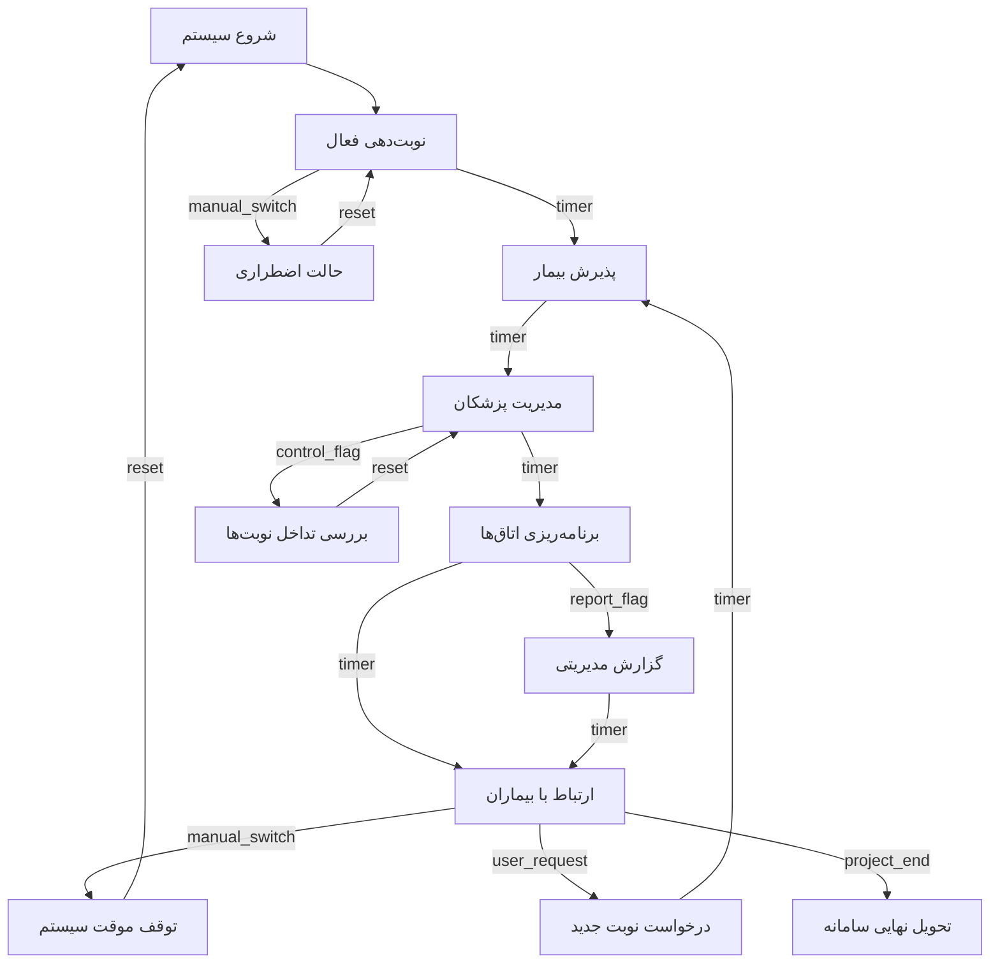

# تخمین زمان هر فاز پروژه (PERT)

تمام زمان‌ها بر اساس روز کاری محاسبه شده‌اند.

---

## فاز اول: آغاز پروژه (Initiation)

- زمان خوش‌بینانه: ۵ روز  
- زمان واقع‌بینانه: ۷ روز  
- زمان بدبینانه: ۱۰ روز  

فرمول محاسبه زمان مورد انتظار (PERT):

ET = (زمان خوش‌بینانه + 4 × زمان واقع‌بینانه + زمان بدبینانه) / 6  
ET = (5 + 4×7 + 10) / 6  
ET = 43 / 6 ≈ 7.17

زمان مورد انتظار: ۷ روز

---

## فاز دوم: برنامه‌ریزی پروژه (Planning)

- زمان خوش‌بینانه: ۷ روز  
- زمان واقع‌بینانه: ۹ روز  
- زمان بدبینانه: ۱۳ روز  

ET = (7 + 4×9 + 13) / 6  
ET = 56 / 6 ≈ 9.33

زمان مورد انتظار: ۹ روز

---

## فاز سوم: اجرای پروژه (Execution)

- زمان خوش‌بینانه: ۲۰ روز  
- زمان واقع‌بینانه: ۲۵ روز  
- زمان بدبینانه: ۳۲ روز  

ET = (20 + 4×25 + 32) / 6  
ET = 152 / 6 ≈ 25.33

زمان مورد انتظار: ۲۵ روز

---

## فاز چهارم: خاتمه پروژه (Closedown)

- زمان خوش‌بینانه: ۲ روز  
- زمان واقع‌بینانه: ۳ روز  
- زمان بدبینانه: ۵ روز  

ET = (2 + 4×3 + 5) / 6  
ET = 19 / 6 ≈ 3.17

زمان مورد انتظار: ۳ روز

---

# جمع‌بندی زمان کل پروژه

| فاز پروژه        | زمان مورد انتظار |
|------------------|------------------|
| آغاز پروژه       | ۷ روز            |
| برنامه‌ریزی      | ۹ روز            |
| اجرای پروژه      | ۲۵ روز           |
| خاتمه پروژه      | ۳ روز            |
| مجموع کل         | ۴۴ روز کاری      |

---

# مسیر بحرانی (Critical Path)

در فاز اجرای پروژه، فعالیت‌ها به شکل زیر تعریف شده‌اند:

| فعالیت              | مدت‌زمان | پیش‌نیاز                         |
|---------------------|----------|----------------------------------|
| تحلیل نیازمندی‌ها   | ۵ روز    | شروع                              |
| طراحی دیتابیس       | ۴ روز    | تحلیل نیازمندی‌ها                |
| طراحی رابط کاربری   | ۳ روز    | تحلیل نیازمندی‌ها                |
| توسعه ماژول‌ها      | ۱۰ روز   | طراحی دیتابیس و رابط کاربری      |
| تست سیستم           | ۴ روز    | توسعه ماژول‌ها                    |
| آموزش کارکنان       | ۲ روز    | تست سیستم                         |

نکته: طراحی دیتابیس و طراحی رابط کاربری می‌توانند هم‌زمان انجام شوند.

### محاسبه مسیر بحرانی

مدت مسیر بحرانی:

۵ + ۴ + ۱۰ + ۴ + ۲ = ۲۵ روز

مسیر بحرانی شامل فعالیت‌های زیر است:

تحلیل نیازمندی‌ها → طراحی دیتابیس → توسعه ماژول‌ها → تست سیستم → آموزش کارکنان

مدت مسیر بحرانی: ۲۵ روز کاری

---

# محاسبه زمان شناوری (Slack Time)

### فعالیت: طراحی رابط کاربری

- زودترین زمان شروع: روز ۵  
- زودترین زمان پایان: روز ۸  
- دیرترین زمان شروع: روز ۶  
- دیرترین زمان پایان: روز ۹  

محاسبه شناوری:

Slack = دیرترین زمان پایان − زودترین زمان پایان  
Slack = 9 − 8 = 1

زمان شناوری طراحی رابط کاربری برابر با ۱ روز است؛ یعنی این فعالیت می‌تواند یک روز با تأخیر انجام شود بدون اینکه زمان تحویل کل پروژه تغییر کند.


____________________________________________________________________________
```
📦 پروژه سیستم انبارداری
│
├── 1. فاز تحلیل
│     ├── 1.1 استخراج نیازمندی‌ها
│     └── 1.2 مدل‌سازی جریان داده (DFD)
│
├── 2. فاز طراحی
│     ├── 2.1 طراحی مدل داده‌ها (ERD)
│     └── 2.2 طراحی رابط کاربری (UI/UX)
│
└── 3. فاز پیاده‌سازی
      ├── 3.1 توسعه ماژول‌ها
      └── 3.2 تست و رفع خطا
```
_____________________________________________________________

```mermaid
flowchart LR
    A[شروع پروژه] --> B[جمع‌آوری نیازمندی‌ها]
    B --> C[تحلیل فرآیندهای نوشتن و پذیرش]
    C --> D[طراحی دیتابیس]
    D --> E[طراحی رابط کاربری]
    E --> F[پیاده‌سازی ماژول نوشتن]
    F --> G[پیاده‌سازی ماژول پزشکان]
    G --> H[پیاده‌سازی ماژول اتاق‌های معاینه]
    H --> I[تست سیستم]
    I --> J[آموزش کارکنان]
    J --> K[تحویل نهایی]
```




_____________________________________________________________________
| محور مقایسه | نمودار گانت (Gantt Chart) | نمودار شبکه (Network Diagram) |
|-------------|----------------------------|--------------------------------|
| شکل ظاهری | میله‌های افقی روی محور زمان | گره‌ها و فلش‌های جهت‌دار |
| تمرکز اصلی | زمان شروع، پایان و مدت تسک‌ها | روابط پیش‌نیازی و وابستگی‌ها |
| نمایش هم‌پوشانی | نمایش واضح هم‌پوشانی زمانی | نمایش ضعیف هم‌پوشانی تقویمی |
| مسیر بحرانی | تشخیص سخت‌تر | نمایش دقیق مسیر بحرانی |
| مخاطب | مدیران ارشد و افراد غیر فنی | تحلیل‌گران و مدیران پروژه |

__________________________________________________________________

_______________________________________________
```mermaid
    gantt
    dateFormat  YYYY-MM-DD
    title  نمودار گانت پروژه سیستم نوبت‌دهی بیمارستان

    section فاز آغازین
    تشکیل تیم اولیه           :done,    a1, 2024-01-01, 3d
    جلسات با مدیریت           :active,  a2, 2024-01-04, 4d
    جمع‌آوری نیازها           :         a3, 2024-01-08, 5d

    section فاز برنامه‌ریزی
    تعریف محدوده پروژه        :         b1, 2024-01-13, 4d
    ساخت WBS                  :         b2, 2024-01-17, 3d
    زمان‌بندی اولیه           :         b3, 2024-01-20, 4d
    تحلیل ریسک‌ها             :         b4, 2024-01-24, 3d

    section فاز اجرا
    تحلیل نیازمندی‌ها         :         c1, 2024-01-27, 6d
    طراحی دیتابیس             :         c2, 2024-02-02, 5d
    توسعه ماژول‌ها            :         c3, 2024-02-07, 10d
    تست اولیه                 :         c4, 2024-02-17, 5d

    section فاز خاتمه
    تحویل نهایی               :         d1, 2024-02-22, 3d
    آموزش کارکنان             :         d2, 2024-02-25, 2d
    بازبینی نهایی             :         d3, 2024-02-27, 2d

